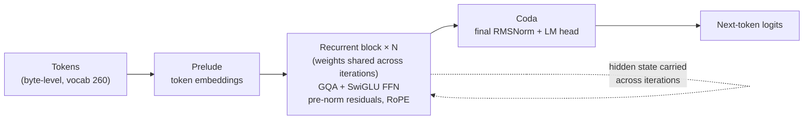
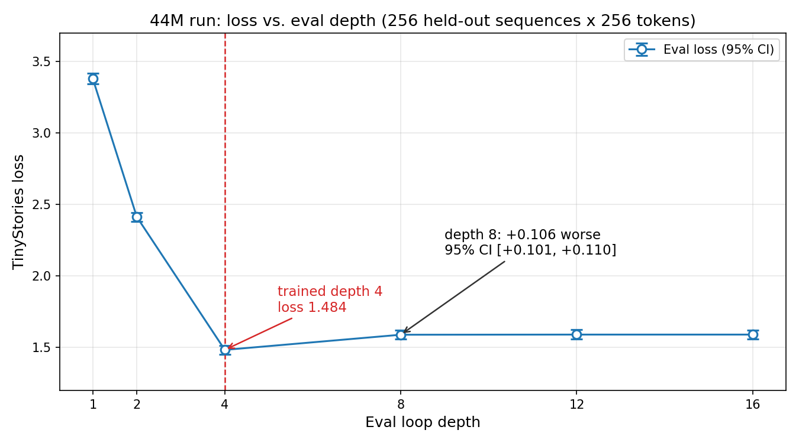

# OpenMythos

[](https://github.com/themythofsisyphusjayant/OPENMYTHOS-RLM)
[](LICENSE)
[](tests/test_all.py)

A recurrent language model, built from scratch, designed to train on a
single NVIDIA T4 (16 GB) in Google Colab.

The research question: can a model that reuses one block across iterations
buy effective depth more cheaply than a wider model with the same parameter
count? This repo is the test of that question — a small, fully verified
implementation, two pilot runs, and a 1B roadmap.

## Architecture

Prelude → Recurrent Block × N → Coda, with the block's weights shared across
iterations:

- **Prelude**: byte-level token embeddings (vocab 260, no tokenizer training
  needed).
- **Recurrent block** (shared): grouped-query attention + SwiGLU FFN (or
  sparse MoE), pre-norm residuals, RoPE position embeddings.
- **Coda**: final RMSNorm + LM head (optionally tied).



Two engineering consequences of the design are handled explicitly:

1. **Truncated BPTT** — gradients flow through at most
   `grad_recurrence_steps` iterations (state detached between chunks).
2. **Per-iteration KV caches** — each iteration attends over a different
   input distribution, so generation keeps one cache per iteration depth
   (see `openmythos/recurrent.py`).

## Results

Every module is shape-checked and the whole pipeline runs end to end. The
experimental record is in `research/`, and it is reported honestly — the
headline hypothesis did not survive the first pilot.

### 44M run (Stage 0, TinyStories)

The 44M model was trained against a matched-parameter baseline. On
TinyStories loss, test-time depth extrapolation did not help: evaluating at
depth 8 was significantly worse than the trained depth 4 (paired difference
+0.106 loss, 95% CI [+0.101, +0.110]). Full numbers, confidence intervals,
compute, and limitations are in
[`research/44m_experiment_report.md`](research/44m_experiment_report.md)
§4.

**Loop-depth sweep** — same weights, same 256 held-out TinyStories
sequences × 256 tokens, evaluated at each depth:

| Eval depth | Loss | 95% CI (bootstrap) | Perplexity |
|---:|---:|---:|---:|
| 1 (baseline: no recurrence) | 3.380 | [3.343, 3.418] | 29.38 |
| 2 | 2.414 | [2.384, 2.446] | 11.18 |
| **4 (trained depth)** | **1.484** | **[1.454, 1.516]** | **4.41** |
| 8 | 1.590 | [1.559, 1.621] | 4.90 |
| 12 | 1.591 | [1.560, 1.624] | 4.91 |
| 16 | 1.591 | [1.560, 1.623] | 4.91 |

**Paired difference, depth 4 → 8:** +0.106 loss, 95% CI [0.101, 0.110] —
depth 8 is significantly worse, not just noisier. Depths 12 and 16 are
identical to each other (1.591): past the trained depth, extra loops
saturate, they do not compound.



*Loss vs. eval depth for the 44M run — same weights, 256 held-out TinyStories
sequences × 256 tokens; error bars are the 95% bootstrap CIs from the table
above. Depth 4 is the trained depth (loss 1.484); depth 8 is +0.106 worse,
95% CI [+0.101, +0.110]; depths 12 and 16 saturate at 1.591.*

**Training setup** (as logged by the run):

| Item | Value |
|---|---|
| Parameters | 43,974,722 (run-printed) |
| Architecture | Prelude (6 layers) → shared recurrent block → Coda (2 layers) |
| Loop iterations (trained) | 4 |
| Attention | Grouped-query attention (GQA) + RoPE |
| Feed-forward | Sparse MoE, 8 experts |
| Tokenizer | GPT-2 BPE, vocab 50,257 |
| Recurrent stability | Spectral radius ρ(A) max = 0.3679 (< 1, contractive) |
| Data | TinyStories (streamed) |
| Token budget | ~120M tokens (119.2M logged at step 4,850) |
| Hardware | Kaggle Tesla T4, 15 GB, fp16 autocast |
| Optimizer steps | 4,850 (~2.5 GPU-hours; 152 min logged) |
| Throughput | ~13.1k tokens/s, steady |
| LR schedule | Warmup to 3.00e-04, cosine decay to ~0 (3.95e-08 at step 4,850) |
| Gradient clipping | 1.0 |
| Training loss | 9.5242 (step 50) → 1.5263 (step 4,850) |

**Reading.** Recurrence is doing real work: at identical parameters, depth
4 beats depth 1 by 1.90 loss points (perplexity 29.4 → 4.4). But the gain
is a *trained-depth* phenomenon. Nothing in this run supports the roadmap's
"test-time depth extrapolation" claim at 44M scale on TinyStories loss:
extrapolation costs +0.11 loss and then flatlines. Whether a loop-depth
*curriculum* (training across depths, as the 1B plan proposes) changes this
is an open hypothesis, not an established property.

**Compute, honestly.** At depth 4 the loop block runs 4× per token, so the
44M model costs roughly 4× the loop-block compute of its own 44M unlooped
baseline. Any efficiency claim must be stated in compute (tokens,
GPU-hours), not parameters. The 6ND figure (~3 × 10¹⁶ FLOPs) is an upper
bound: with sparse MoE only a fraction of experts is active per token, so
true training FLOPs are lower and were not directly measured. No external
model was retrained as a baseline; depth 1 is an internal, matched-parameter
control, not a tuned competitor.

**Limitations.** Single seed (a second seed is the main open gap); TinyStories
only; loss/perplexity only, no downstream task scores, no human eval; MoE
routing unanalyzed. One codebase note: this run used the `kyegomez/OpenMythos`
package (pip `open-mythos`), not the from-scratch code in this repo — the
report lives here because this is the project's research home.

### MiniMythos 125M (reported, not reproduced)

A second data point, from a report rather than a run in this repo: zero-shot
HellaSwag 29.5% → 30.0% (8 → 16 loops), PIQA flat at 50.0% — which is
chance level on a 2-choice task, so it shows no PIQA knowledge rather than
robustness. See
[`research/minimythos_125m_addendum.md`](research/minimythos_125m_addendum.md).

| Model | HellaSwag | PIQA |
|---|---:|---:|
| GPT-2 Small (124M) | 28.5 | 62.8 |
| TinyLlama-120M | 31.5 | 64.2 |
| MiniMythos (8 loops) | 29.5 | 50.0 |
| MiniMythos (16 loops) | 30.0 | 50.0 |

Provenance: numbers are taken from a July 2026 one-page summary and slides
("MiniMythos 125M — A Case for Recurrent Virtual Depth", ONI CHAIN Research
Notebook, v1.0). They are **not** independently verified runs: the summary
gives no seeds, no confidence intervals, and no eval code. Treat every figure
as reported, not reproduced. No MiniMythos ARC-Challenge number is given in
the summary (baselines: GPT-2 Small 21.0, TinyLlama-120M 23.5) — that gap is
flagged, not filled. "7 → 22 effective layers" is the summary's arithmetic,
not a measured quantity.

**Reconciliation.** The two results do not contradict each other, but they
narrow the claim: 44M, TinyStories *loss*, fixed-depth training —
extrapolating past the trained depth (4 → 8) **hurt** significantly. 125M,
zero-shot *accuracy*, loop-agnostic training — going 8 → 16 loops **helped**
HellaSwag (+0.5pt) and held PIQA flat. Two differences could explain this,
both hypotheses, not findings: scale (125M vs 44M), and training recipe
(loop-agnostic training is designed to stabilize hidden states across
depths, while the 44M run trained at a single fixed depth).

Taken together, depth extrapolation currently looks scale- and
task-dependent, not settled either way. The 1B loop-curriculum run is the
experiment that would decide it, and it has not been run.

## Quick start

Requires Python 3.10+ and `torch>=2.2`, `numpy>=1.24`, `tqdm>=4.64`
(`requirements.txt`).

```bash
pip install -r requirements.txt

# 1. Smoke test: does the model run? (~1M params, CPU, seconds)
python -m openmythos.benchmark --preset tiny_debug --mode train --steps 5

# 2. Hardware check: parameter count + VRAM estimate for the real model
python -m openmythos.benchmark --preset mini_60m --mode params
python -m openmythos.benchmark --preset mini_60m --mode vram

# 3. Train (on a T4; see COLAB.md)
python -m openmythos.train --preset mini_60m \
    --train-data data/train.txt --val-data data/val.txt

# 4. Evaluate / generate
python -m openmythos.evaluate --ckpt checkpoints/final.pt --text data/val.txt
```

`data/` and `checkpoints/` are not in the repo; bring your own training text
and the run creates its checkpoints.

### CPU pilot

`experiments/pilot_cpu.py` trains a 722K-parameter recurrent LM on CPU
(Gutenberg corpus) end to end — data → train → eval perplexity →
checkpoint → generate — proving the full pipeline before any GPU time is
spent.

## Presets

| Preset | Params | Purpose |
|---|---|---|
| `tiny_debug` | ~1M | CPU smoke tests: forward/backward/generate in seconds |
| `mini_60m` | ~62M | Reference model for a single T4 |

Run `python -m openmythos.benchmark --preset mini_60m --mode params` for the
exact count. The `mini_60m` defaults are `d_model=2048`, 32 query heads / 8
KV heads (GQA), `d_ff=8192`, 8 recurrent iterations, byte-level vocab 512,
max sequence 2048; training defaults are seq len 1024, micro-batch 4 ×
grad-accum 16 (effective batch 64), 20,000 steps, lr 3e-4 with 1,000 warmup
steps, weight decay 0.1, grad clip 1.0, betas (0.9, 0.95), bfloat16 autocast
on CUDA. See `openmythos/config.py`.

## Layout

| File | Purpose |
|---|---|
| `openmythos/config.py` | Model/train configs, `tiny_debug` and `mini_60m` presets |
| `openmythos/tokenizer.py` | Byte-level tokenizer (no training step) |
| `openmythos/embeddings.py` | RMSNorm, token embeddings |
| `openmythos/attention.py` | GQA + RoPE + SDPA (FlashAttention when available), KV cache |
| `openmythos/moe.py` | SwiGLU FFN, sparse MoE with load-balancing loss |
| `openmythos/recurrent.py` | Shared recurrent block, truncated BPTT, per-iteration caches |
| `openmythos/model.py` | Prelude → RecurrentStack → Coda |
| `openmythos/dataset.py` | Text chunking + dataloaders |
| `openmythos/optimizer.py` | AdamW, selective weight decay |
| `openmythos/scheduler.py` | Linear warmup + cosine decay |
| `openmythos/trainer.py` | Loop: grad accumulation, AMP, clipping, ckpt save/resume |
| `openmythos/inference.py` | Generation with per-iteration KV caches |
| `openmythos/evaluate.py` | Perplexity CLI |
| `openmythos/benchmark.py` | Params / VRAM / tok-s smoke tests |
| `openmythos/export.py` | HF-style export (config.json + weights) |
| `openmythos/train.py` | Training CLI entry point |
| `tests/test_all.py` | Test suite — 13 tests |
| `COLAB.md`, `colab_t4.ipynb` | Colab setup for a T4 |
| `configs/` | 1B and 3B configs (see below) |
| `research/` | Experiment reports, battle plan, competitive survey, beginner explainers |
| `patches/` | QK-Norm and sliding-window interleave, documented against upstream |
| `experiments/pilot_cpu.py` | CPU pilot |

## Reproducibility

- All randomness is seeded (`TrainConfig.seed`); dataloader shuffling uses a
  seeded generator.
- Checkpoints store model, optimizer, scaler, and RNG states — resume with
  `--resume checkpoints/latest.pt`.
- Every run appends JSONL metrics to `checkpoints/loss.jsonl`.

## Patches (against upstream)

Two architectural imports for the 1B plan, documented in `patches/` against
`kyegomez/OpenMythos` (`open_mythos/main.py`):

- **QK-Norm** (`patches/qk_norm.md`): RMSNorm on queries and keys
  pre-softmax. Qwen3 added it for training stability; a looped recurrent
  block re-processes tokens up to 16×, so attention-logit blowup across
  iterations is the #1 instability risk — this is the single highest-EV
  architectural import in the 1B plan.
- **Sliding-window interleave** (`patches/sliding_window.md`): alternating
  sliding-window attention layers, as in the 1B plan.

## Roadmap: 1B

The T4-scale pilots validate the recurrent-depth idea as an implementation.
The milestone is a 1B-parameter OpenMythos trained and evaluated against the
open 1B class: TinyLlama-1.1B, SmolLM2-1.7B, OLMo-2-1B, Llama-3.2-1B,
Qwen2.5-1.5B.

- `configs/mythos_1b.py` — 1B config, verified at 1,056,094,338 params
  (forward pass smoke-tested on CPU): GQA 16/4, 64 experts / 8 active,
  64K custom BPE, 4K context, 16 max loop iterations, loop-depth
  curriculum. Config only — the training run has not happened.
- `configs/mythos_3b.py` — a 3B config, same family.
- `research/1b_battle_plan.md` — the plan: targets, data mix, recipe,
  compute stages.
- `research/3b_landscape.md` — competitive survey (12 models) behind the
  plan.
- `research/44m_experiment_report.md` — Stage-0 evidence (see Results).
- `research/minimythos_125m_addendum.md` — the reported 125M second data
  point.

### The 1B config

| Item | Value |
|---|---|
| Parameters | 1,056,094,338 (verified; forward pass smoke-tested on CPU) |
| Dimensions | `dim=2048`, 16 heads / 4 KV heads (GQA 16/4, not MLA — proven at this scale) |
| MoE | 64 experts / 8 active / 0 shared (Qwen3-style fine-grained, no shared expert), expert dim 2048 |
| Vocabulary | 64K custom BPE, trained on the data mix; embeddings tied |
| Context | 4,096 tokens |
| Loops | 16 max; loop-depth curriculum — steps 0–20% at 2 loops, 20–80% at 4, anneal at 8, eval sweep {4, 8, 16} |
| Stability | QK-Norm + sliding-window interleave (via `patches/`), RoPE θ = 500,000, dropout 0.0 |

Two caveats, stated plainly: the 1B config imports a model module
(`open_mythos.main`) that is not in this repo, and the loop-curriculum
training code it refers to is not here either — the config is verified for
its parameter count, not as a runnable training setup. And the
extrapolation claim the roadmap rests on — train with n_loops ≤ 8, sweep
4→16 at eval — is unproven: the 44M run contradicts it on TinyStories loss
and the 125M report supports it only weakly on HellaSwag.

Beginner explainers for the 44M run, MiniMythos 125M, and the 1B roadmap
are in `research/` (`*-explained-for-beginners.md`).

## License

MIT — see [LICENSE](LICENSE).
